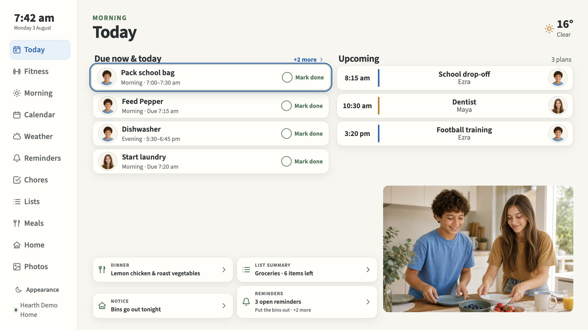

# Hearth

**Your family’s day, together.** A calm family dashboard for your TV, managed from your phone
and hosted on your own private server. Home Assistant is optional.

[Explore Hearth](https://davidjpramsay.github.io/Hearth/) ·
[Installation guide](hearth/deploy/portable/README.md) ·
[Release readiness](docs/hearth-v2/PUBLIC_RELEASE_READINESS.md)



## What it does

- **Today and Calendar:** upcoming plans, chores and useful household information at a glance.
- **Morning Routine:** separate school-day and weekend checklists, with optional countdowns.
- **Fitness:** several goals per person, weekly sessions, scheduled-day streaks and reusable
  exercise instructions with optional private video demonstrations.
- **Everyday life:** household reminders, lists, meals, photos, weather and optional indoor sensors.
- **Choose your modules:** hide features without deleting their data. Adults manage the home from
  a phone or iPad; approved shared screens use a TV remote or touch.
- **Family games:** local two-player Connect Four and a Connections-style word game, with separate
  On/Off choices. [Private puzzle content setup](hearth/content/connections/README.md); no NYT archive
  is included.
- **Optional connections:** calendar providers and Home Assistant can add schedules, home actions
  and automations. Hearth’s core household features work without Home Assistant or an LLM.

## Try it at home

Hearth is an **early release for technically comfortable households**, not yet a plug-and-go
consumer appliance. The portable installer currently needs an **x86-64 Linux server**, Docker
Compose, Python 3 and an already trusted **private HTTPS address**. It uses verified, publicly
downloadable container images. ARM images and automatic network/certificate setup are not provided.

1. Follow the [guided fresh installation](hearth/deploy/portable/README.md).
2. Scan the installer’s private setup QR to connect the first owner phone.
3. Approve a browser display or the [Android TV app](hearth/apps/tv/) from that phone.

Keep household access on your LAN or private VPN. The public website is only a product preview;
it does not connect to anyone’s household. Existing commissioned Synology installations keep their
[protected update tools](hearth/deploy/synology/README.md).

## Develop with fictional data

Use Node.js 22.12+ and the pinned pnpm version in [`hearth/package.json`](hearth/package.json):

```sh
cd hearth
pnpm install --frozen-lockfile
pnpm dev
```

Open `http://localhost:4320`. This is the seeded demo, not a production household. Never copy
production secrets or data into it. Run `pnpm verify` for the web/server release gate;
`pnpm verify:tv` covers Android builds, lint and unit tests. Hosted verification also audits
dependencies and tests a fresh private installation before publishing release images.

The app lives in [`hearth/`](hearth/); product contracts and evidence live in
[`docs/hearth-v2/`](docs/hearth-v2/README.md). Read [`AGENTS.md`](AGENTS.md) before contributing.

## Sharing and security

Passing CI is useful evidence, not a security certification. See the
[sharing checklist and remaining work](docs/hearth-v2/PUBLIC_RELEASE_READINESS.md) before
onboarding another household or considering public network exposure. Do not include credentials,
private URLs, setup codes or household data in issues.

Hearth is available under the [MIT licence](LICENSE). Third-party fonts, assets and provider data
retain their own terms. The licence does not redistribute household content or private credentials.

This is the current **Hearth** application. The original implementation is preserved in
[`old_hearth`](https://github.com/davidjpramsay/old_hearth). Existing `hearth-v2-server` and
`hearth-v2-web` container package names are retained for installation and update compatibility.

Game databases are supplied privately by each household. See [game data setup](hearth/content/README.md); no NYT puzzles or downloaded word lists are distributed.
